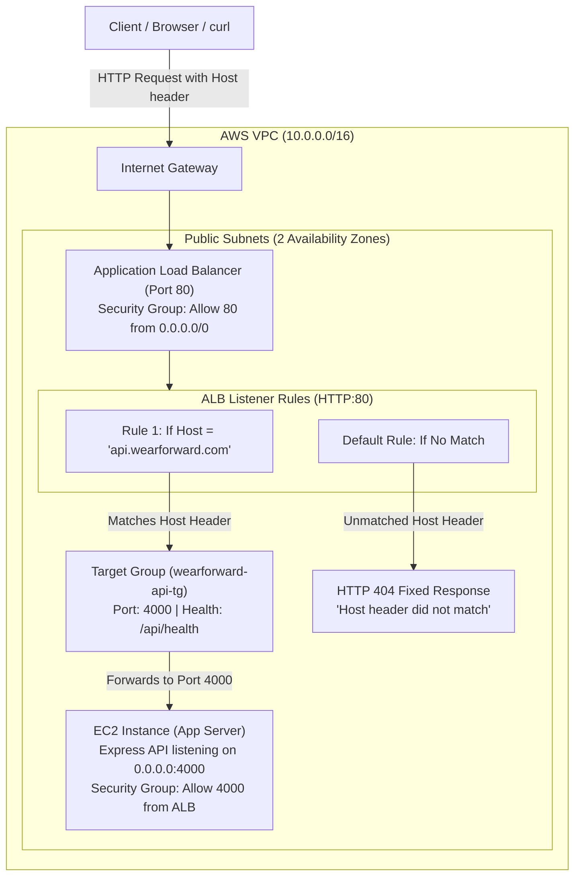

# AWS Deployment Guide: VPC, Target Group, ALB & Host-Based Routing

This guide details how to deploy the **WearForward Clothing Donation App** on AWS using an **Application Load Balancer (ALB)** with **Host-Based Routing** across a custom **VPC**.

---

## 🏗 Architecture Overview



---

## 🚀 Two Deployment Options

1. **Option A (Automated 1-Click)**: Deploy via AWS CloudFormation with our pre-built template [`aws-deploy-artifacts/cloudformation-alb-vpc.yaml`](file:///c:/Users/Manas/OneDrive/Desktop/Donation%20App/aws-deploy-artifacts/cloudformation-alb-vpc.yaml).
2. **Option B (Step-by-Step Console Walkthrough)**: Step-by-step instructions in the AWS Management Console as required by your curriculum.

---

# Option A: 1-Click AWS CloudFormation Deployment

A complete CloudFormation template is generated at [`aws-deploy-artifacts/cloudformation-alb-vpc.yaml`](file:///c:/Users/Manas/OneDrive/Desktop/Donation%20App/aws-deploy-artifacts/cloudformation-alb-vpc.yaml).

### Steps to Deploy:
1. Sign into the **AWS Management Console** and select your preferred Region (e.g., `ap-south-1` Mumbai, `us-east-1` N. Virginia).
2. Open the **CloudFormation** service console.
3. Click **Create stack** -> **With new resources (standard)**.
4. Under *Prerequisite - Prepare template*, choose **Template is ready**.
5. Under *Template source*, choose **Upload a template file** -> Select `cloudformation-alb-vpc.yaml`.
6. Click **Next**.
7. Enter a Stack name: `wearforward-alb-stack`.
8. Review Parameters:
   - `HostHeaderDomain`: `api.wearforward.com` (or your domain).
   - `InstanceType`: `t3.micro` (free-tier eligible).
9. Click **Next**, leave default options, click **Next**, and click **Submit**.
10. Wait 3–4 minutes until status shows **CREATE_COMPLETE**.
11. Click the **Outputs** tab to retrieve:
    - `ALBDNSName`
    - Pre-formatted curl commands for testing!

---

# Option B: AWS Management Console Step-by-Step Guide

Follow these exact steps to manually configure the VPC, EC2 instance, Target Group, ALB, and Host-Based Routing rule.

---

### Part 0: Create the VPC & Subnets

An Application Load Balancer requires **at least two Availability Zones** (AZs).

1. In the AWS Console, search for and open **VPC**.
2. Click the orange **Create VPC** button.
3. Under *Resources to create*, select **VPC and more** (this configures subnets, IGW, and route tables in one screen):
   - **Name tag auto-generation**: `wearforward`
   - **IPv4 CIDR block**: `10.0.0.0/16`
   - **Number of Availability Zones (AZs)**: `2`
   - **Number of public subnets**: `2`
   - **Number of private subnets**: `0`
   - **NAT gateways ($)**: `None`
   - **VPC endpoints**: `None`
4. Click **Create VPC**. Wait for the resources to finish provisioning, then click **View VPC**.

---

### Part 1: Launch the EC2 Application Instance

1. In the AWS Console, search for and open **EC2**.
2. Click **Instances** -> **Launch instances**.
3. **Name**: `wearforward-api-server`.
4. **Application and OS Images (AMI)**: Select **Amazon Linux 2023 AMI**.
5. **Instance type**: `t2.micro` or `t3.micro` (Free-tier eligible).
6. **Key pair**: Select an existing key pair or *Proceed without a key pair* if SSH is not needed.
7. **Network settings** (Click **Edit**):
   - **VPC**: Select your newly created `wearforward-vpc`.
   - **Subnet**: Select one of the public subnets (e.g., `wearforward-subnet-public1`).
   - **Auto-assign public IP**: **Enable**.
   - **Firewall (security groups)**: Select **Create security group**:
     - Security group name: `wearforward-ec2-sg`
     - Description: `Security group for WearForward backend instance`
     - Inbound Rule 1 (SSH): Type `SSH`, Port `22`, Source `My IP` (or `0.0.0.0/0`).
     - Inbound Rule 2 (App Port): Type `Custom TCP`, Port `4000`, Source `0.0.0.0/0` (where application is listening).
     - Inbound Rule 3 (HTTP): Type `HTTP`, Port `80`, Source `0.0.0.0/0`.
8. Scroll down to **Advanced details** -> Expand it -> Scroll to **User data**.
9. Paste the following startup script (starts our Express backend listening on port 4000):

```bash
#!/bin/bash
dnf update -y
dnf install -y nodejs npm git

mkdir -p /opt/wearforward-api
cd /opt/wearforward-api

cat << 'EOF' > package.json
{
  "name": "wearforward-api",
  "version": "1.0.0",
  "main": "server.js",
  "dependencies": {
    "express": "^4.19.2",
    "cors": "^2.8.5"
  }
}
EOF

cat << 'EOF' > server.js
const express = require('express');
const cors = require('cors');
const app = express();
const PORT = process.env.PORT || 4000;

app.use(cors());
app.use(express.json());

app.use((req, res, next) => {
  res.setHeader('X-Served-By', String(PORT));
  res.setHeader('X-Matched-Host', req.headers['host'] || 'unknown');
  next();
});

app.get('/health', (req, res) => {
  res.status(200).json({
    status: 'ok',
    service: 'WearForward Clothing Donation API',
    port: PORT,
    pid: process.pid,
    hostHeaderReceived: req.headers['host'],
    timestamp: new Date().toISOString()
  });
});

app.get('/api/health', (req, res) => {
  res.status(200).json({
    status: 'ok',
    service: 'WearForward Clothing Donation API',
    port: PORT,
    pid: process.pid,
    hostHeaderReceived: req.headers['host'],
    timestamp: new Date().toISOString()
  });
});

app.listen(PORT, '0.0.0.0', () => {
  console.log(`WearForward API server running on port ${PORT}`);
});
EOF

npm install --production

cat << 'EOF' > /etc/systemd/system/wearforward.service
[Unit]
Description=WearForward Donation App Node.js Service
After=network.target

[Service]
Type=simple
User=root
WorkingDirectory=/opt/wearforward-api
ExecStart=/usr/bin/node server.js
Restart=always
RestartSec=10
Environment=PORT=4000 NODE_ENV=production

[Install]
WantedBy=multi-user.target
EOF

systemctl daemon-reload
systemctl enable wearforward.service
systemctl start wearforward.service
```

10. Click **Launch instance**.

---

### Step 1: Create Target Group (Port where application is listening)

1. In the EC2 Console left sidebar, scroll down to **Load Balancing** and click **Target Groups**.
2. Click **Create target group**.
3. Choose basic configuration:
   - **Target type**: Select **Instances**.
   - **Target group name**: `wearforward-api-tg`
   - **Protocol**: `HTTP`
   - **Port**: `4000` *(Application is listening on port 4000)*
   - **IP address type**: `IPv4`
   - **VPC**: Select `wearforward-vpc`
   - **Protocol version**: `HTTP1`
4. Health checks:
   - **Health check protocol**: `HTTP`
   - **Health check path**: `/api/health`
5. Expand **Advanced health check settings**:
   - **Healthy threshold**: `2`
   - **Unhealthy threshold**: `3`
   - **Timeout**: `5` seconds
   - **Interval**: `15` seconds
   - **Success codes**: `200`
6. Click **Next**.
7. **Register targets**:
   - In the *Available instances* table, check the box next to your instance: `wearforward-api-server`.
   - Ensure the port entered under *Ports for the selected instances* is `4000`.
   - Click the button **Include as pending below**.
   - Verify the instance appears in *Targets to be registered* on Port 4000.
8. Click **Create target group**.

---

### Step 2: Create an Application Load Balancer (ALB)

1. In the EC2 Console left sidebar, click **Load Balancers**.
2. Click **Create load balancer**.
3. Under **Application Load Balancer**, click **Create**.
4. Basic configuration:
   - **Load balancer name**: `wearforward-alb`
   - **Scheme**: `Internet-facing`
   - **IP address type**: `IPv4`
5. **Network mapping**:
   - **VPC**: Select `wearforward-vpc`.
   - **Mappings**: Check both Availability Zones (e.g., `ap-south-1a` and `ap-south-1b`).
   - For each selected AZ, pick the corresponding public subnet (`wearforward-subnet-public1` and `wearforward-subnet-public2`).
6. **Security groups**:
   - Click *Create a new security group* (opens a new tab):
     - Name: `wearforward-alb-sg`
     - VPC: Select `wearforward-vpc`
     - Inbound rule: Type `HTTP`, Port `80`, Source `Anywhere-IPv4` (`0.0.0.0/0`).
     - Click **Create security group**.
   - Return to the ALB tab, refresh the security group list, remove the default group, and select `wearforward-alb-sg`.
7. **Listeners and routing**:
   - Protocol: `HTTP`
   - Port: `80`
   - **Default action**: 
     - Option 1 (Return fixed 404 for unmatched hosts): Select **Return fixed response** -> Status code `404` -> Content-Type `application/json` -> Response body: `{"error":"NOT_FOUND","message":"No host header matched default rule"}`.
     - Option 2: Forward to `wearforward-api-tg`.
8. Click **Create load balancer**.
9. Wait 2–3 minutes for the Load Balancer State to transition from `Provisioning` to **`Active`**.
10. Copy the **DNS name** (e.g., `wearforward-alb-123456789.ap-south-1.elb.amazonaws.com`).

---

### Step 3: Add ALB Host-Based Routing Rule & Test

#### 3.1 Adding the Host-Based Routing Rule in ALB

1. In the EC2 Console -> **Load Balancers**, click on `wearforward-alb`.
2. Click the **Listeners and rules** tab.
3. Click the **HTTP:80** listener link to view rules.
4. Under the Rules tab, click **Manage rules** -> **Add rule** (or click the **+** / **Add rule** button).
5. Enter Rule details:
   - **Name**: `api-host-routing`
   - **Tag**: Key `Name`, Value `api-host-rule`
   - Click **Next**.
6. **Define conditions**:
   - Click **Add condition**.
   - Select **Host header**.
   - Enter your chosen host domain name:
     ```text
     api.wearforward.com
     ```
     *(You can also add `api.donationapp.com` if you like)*
   - Click **Next**.
7. **Define actions**:
   - Select action type: **Forward to target groups**.
   - Choose target group: `wearforward-api-tg` (100% weight).
   - Click **Next**.
8. **Set rule priority**:
   - Set priority to `1`.
   - Click **Next**.
9. Review and click **Save**.

Now your ALB is configured with:
- **Priority 1**: When `Host` header equals `api.wearforward.com` -> Forward to Target Group `wearforward-api-tg` (Port 4000).
- **Default Action**: Any other Host header -> Returns HTTP 404 Fixed Response.

---

## 🧪 Testing via ALB DNS + Host Header

Open your terminal (PowerShell or Bash) and execute the tests below.

> Replace `<YOUR_ALB_DNS>` with your actual ALB DNS name from Step 2.

### 1. Test Matched Host Header (`api.wearforward.com`) -> Should Return HTTP 200 OK

```powershell
$albDns = "YOUR_ALB_DNS_NAME"
curl.exe -i -H "Host: api.wearforward.com" "http://$albDns/api/health"
```

**Expected Response**:
```http
HTTP/1.1 200 OK
Date: ...
Content-Type: application/json; charset=utf-8
Content-Length: 172
Connection: keep-alive
X-Served-By: 4000
X-Matched-Host: api.wearforward.com

{
  "status": "ok",
  "service": "WearForward Clothing Donation API",
  "port": 4000,
  "pid": 1234,
  "hostHeaderReceived": "api.wearforward.com",
  "timestamp": "2026-11-24T08:00:00.000Z"
}
```

---

### 2. Test Unmatched / Arbitrary Host Header -> Should Trigger Default Rule (HTTP 404)

```powershell
curl.exe -i -H "Host: wrong-host.example.com" "http://$albDns/api/health"
```

**Expected Response**:
```http
HTTP/1.1 404 Not Found
Date: ...
Content-Type: application/json
Content-Length: 76
Connection: keep-alive

{"error":"NOT_FOUND","message":"No host header matched default rule"}
```

---

### 3. Test Direct ALB DNS (Default Host Header without Custom Host)

```powershell
curl.exe -i "http://$albDns/api/health"
```

Because the `Host` header is the raw ALB DNS name and does NOT match `api.wearforward.com`, the ALB automatically triggers the Default Action (HTTP 404), proving that **Host-based routing is strictly enforced**!

---

## 📋 Summary of Components Configured

| Component | Setting / Name | Purpose |
| :--- | :--- | :--- |
| **VPC** | `wearforward-vpc` (`10.0.0.0/16`) | Isolated virtual network |
| **Subnets** | 2 Public Subnets in 2 AZs | High availability required by ALB |
| **EC2 Server** | `wearforward-api-server` | Hosts Node.js backend on port 4000 |
| **Step 1: Target Group** | `wearforward-api-tg` | Targets EC2 on Port 4000; health check `/api/health` |
| **Step 2: ALB** | `wearforward-alb` (Internet-facing) | Listens on port 80 across public subnets |
| **Step 3: Host Rule** | Condition: `Host == api.wearforward.com` | Routes traffic specifically to `wearforward-api-tg` |
