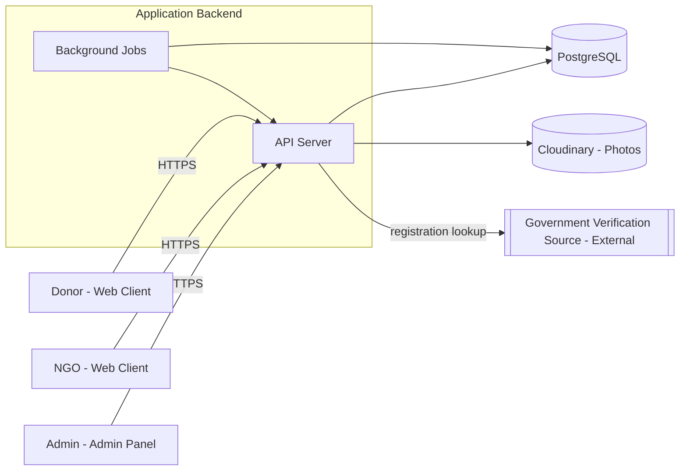
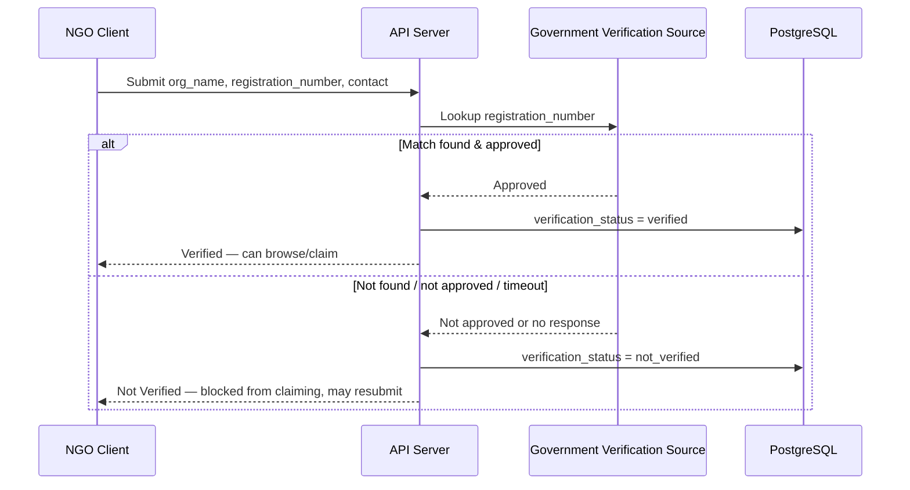
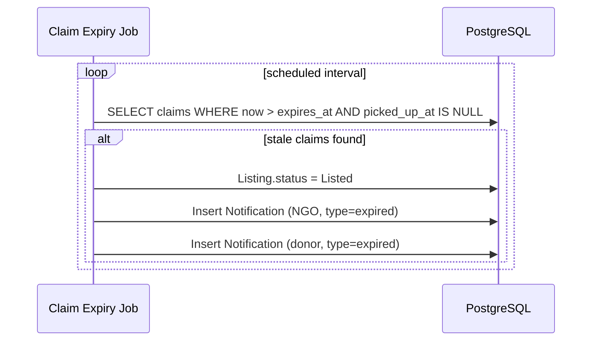
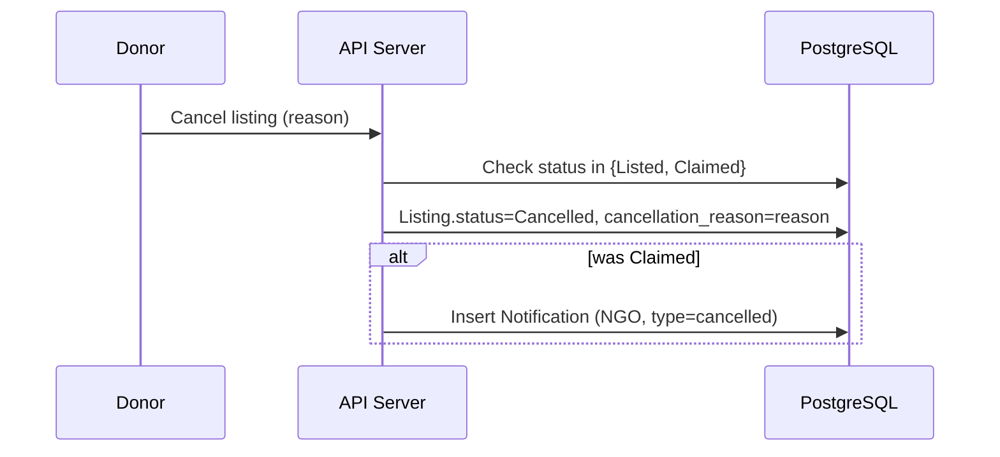

# Clothing Donation App — High-Level Design (HLD)

Status: Draft v1
Source: derived strictly from `spec.md` (MVP Specification v1). Where `spec.md` leaves a technical choice open (§9, §10), this document makes one concrete, clearly-labeled choice from the options `spec.md` already lists, so the design can be built against. No new product behavior is introduced beyond `spec.md`.

## 1. Purpose & Scope

This HLD describes the system architecture needed to deliver the MVP flows defined in `spec.md` §4–§6: listing creation, NGO government verification, claiming, pickup, distribution/delivery, cancellation, claim expiry, and admin moderation. Anything listed in `spec.md` §8 (Out of Scope) is explicitly excluded from this architecture.

## 2. Actors (from spec.md §2)

| Actor | Nature |
|---|---|
| Donor | App user (web/mobile client) |
| NGO | App user (web/mobile client), government-verified org account |
| Admin | Internal user, admin panel (moderation + audit only, per spec.md §6.6 — no verification override power) |
| Receiver | Not a system actor — no account, no client (spec.md §2) |
| Government Verification Source | External system, queried by the backend during NGO signup (spec.md §6.3) |

## 3. Chosen Technology Direction

`spec.md` §9 lists options rather than a final stack. This HLD commits to one path from that list, for concreteness:

| Layer | Choice | Per spec.md §9 option |
|---|---|---|
| Frontend | React (web) | "React (web) or React Native (mobile)" |
| Backend | Node.js/Express | "Node.js/Express or Firebase" |
| Database | PostgreSQL | "PostgreSQL (relational — good fit for status workflows)" — spec.md explicitly favors this for the status-pipeline-driven model in §4 |
| Media storage | Cloudinary | "S3, Firebase Storage, or Cloudinary" |
| Auth | Firebase Auth | "Firebase Auth / Clerk / Auth0" |

This is an engineering-level choice, not a product decision — it does not alter any flow, status, or data rule defined in `spec.md`.

## 4. System Context Diagram



## 5. Component Breakdown

| Component | Responsibility | Maps to spec.md |
|---|---|---|
| **Auth Module** | Signup/login for Donor, NGO, Admin roles | §2, §5 (User) |
| **NGO Verification Service** | Synchronously queries the external government verification source at NGO signup; sets `verified` / `not_verified`; fail-safe to `not_verified` on timeout/outage | §6.3 |
| **Listing Service** | Create listing (multi-item bundle, GPS pickup location), donor cancellation | §5 (Listing), §6.1, §6.2 |
| **Claim Service** | NGO claims a listing, enforces verified-only claiming, tracks 48h expiry window | §5 (Claim), §6.4 |
| **Status Pipeline Engine** | Enforces the fixed status transitions `Listed → Claimed → Picked up → Distributed → Delivered`, with `Cancelled`/expiry side-paths; no skipping | §4 |
| **Distribution Service** | Records receiver first name + general area + optional photo; auto-sets `Delivered` on `Distributed` | §5 (Distribution), §6.4 step 4-5 |
| **Notification Service** | Writes in-app notifications only (no push/SMS/email) on status-change events | §5 (Notification), §3 |
| **Claim Expiry Job** | Background job scanning claims past `expires_at` with no pickup; reverts listing to `Listed`, notifies both parties | §6.5 |
| **Admin Module** | Listing moderation, stale-claim visibility, read-only NGO verification audit log | §6.6 |
| **Media Storage** | Stores listing item photos and optional handover photos | §5, §9 |

No component performs manual NGO approval/rejection — this is intentionally absent per spec.md §3 ("no manual admin review fallback") and §6.6.

## 6. Key Flow Diagrams

### 6.1 NGO Signup & Verification (spec.md §6.3)



### 6.2 Create Listing → Claim → Pickup → Distribute (spec.md §6.1, §6.4)

```mermaid
sequenceDiagram
    participant D as Donor
    participant API as API Server
    participant DB as PostgreSQL
    participant N as Verified NGO

    D->>API: Create listing (items[], GPS pickup_location)
    API->>DB: Insert Listing (status=Listed)
    N->>API: Browse open listings (nearby)
    N->>API: Claim listing
    API->>DB: Insert Claim (expires_at = now+48h); Listing.status=Claimed
    API->>DB: Insert Notification (donor, type=claimed)
    N->>API: Mark Picked up
    API->>DB: Claim.picked_up_at=now; Listing.status="Picked up"
    API->>DB: Insert Notification (donor, type=picked_up)
    N->>API: Mark Distributed (receiver_first_name, general_area, photo?)
    API->>DB: Insert Distribution; Listing.status=Distributed→Delivered (auto)
    API->>DB: Insert Notification (donor, type=distributed) + (donor, type=delivered)
```

### 6.3 Claim Expiry (spec.md §6.5)



### 6.4 Donor Cancellation (spec.md §6.2)



## 7. Data Ownership View

One relational database (PostgreSQL) owns all entities defined in spec.md §5: `User`, `Listing`, `Claim`, `Distribution`, `Notification`. No separate service owns its own datastore in the MVP — a single backend keeps the fixed, linear status pipeline (spec.md §4) easy to enforce transactionally. Detailed schema is in `LLD.md`.

## 8. Security & Trust Mapping (spec.md §7)

| Principle (spec.md §7) | Architectural mechanism |
|---|---|
| Donor has full visibility at every step | Listing status + Notification records queryable by donor_id |
| Receiver info minimal & non-identifying | Distribution table only stores first name + general area, never full identity |
| Handover photo optional | `photo_url` nullable in Distribution |
| Only government-verified NGOs can claim/distribute | Claim Service checks `User.verification_status = verified` before allowing claim; enforced server-side, not just UI-side |
| Donor's precise GPS visible only to claiming NGO | API returns full `pickup_location` only to the NGO on the Claim record; browse listing returns approximate distance only (open item, spec.md §10) |

## 9. Out of Scope (carried from spec.md §8)

No architecture is built for: payments, direct receiver accounts, real-time GPS tracking, multi-language, ratings/reviews, push/SMS/email/WhatsApp notifications, in-app chat, map view, impact dashboards, gamification. These require no components in this HLD.

## 10. Open Items Carried Forward (from spec.md §10)

These remain unresolved at the HLD level and are called out again in `LLD.md` where they affect concrete design:
- Exact "nearby" radius/sort algorithm.
- Whether donor's precise pin is masked pre-claim.
- Which government verification source/API to integrate with.
- Re-check semantics for a `not_verified` NGO resubmitting corrected details.
