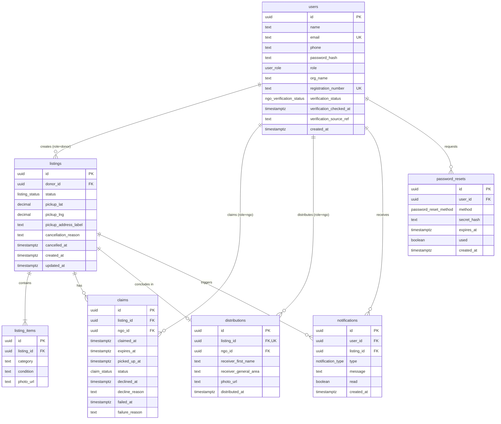
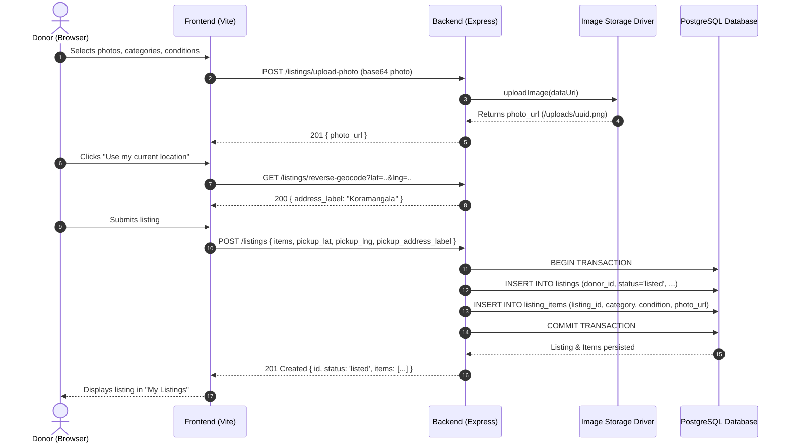
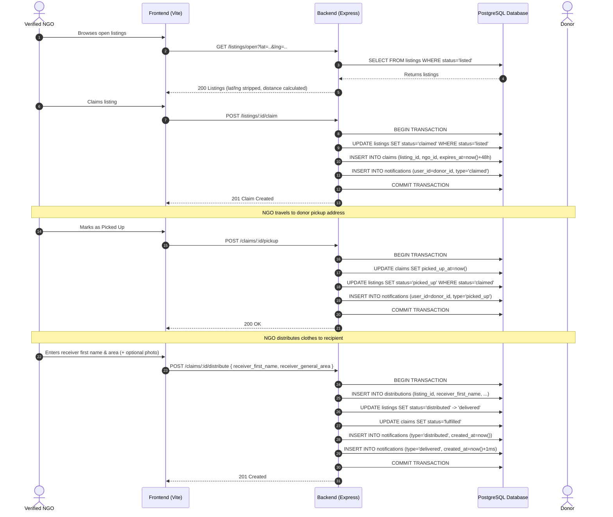

# Clothing Donation App (WearForward) — Full Project Technical Analysis

> **Notice:** This document is strictly compiled from the actual code, configuration files, `package.json`, `.env.example`, migrations, test files, and architectural documentation (`Design/HLD.md`, `Design/LLD.md`, `Spec/spec.md`). Nothing is guessed. Where a feature or tool is absent, it is explicitly marked as `NOT FOUND IN CODE`.

---

## 1. TECH STACK

### Backend Dependencies (`Code/backend/package.json`)
* **Runtime:** Node.js (CommonJS modules, `node:22-bookworm-slim` in Docker, tested on Node 20 and Node 24).
* **`express` (`^5.2.1`):** Core web application framework. Handles HTTP routing, middleware pipeline, JSON request body parsing (`express.json({ limit: '8mb' })`), static asset serving (`express.static`), and native async error propagation.
* **`pg` (`^8.23.0`):** Non-blocking PostgreSQL client for Node.js. Used as the SQL driver by Knex and called directly in test scripts (`scripts/run-tests.js`) to create and verify test databases.
* **`knex` (`^3.3.0`):** SQL query builder and schema migration tool. Manages database migrations (`migrations/`), seed files (`seeds/`), parameterized SQL queries, connection pooling, and atomic transactions (`db.transaction`).
* **`jsonwebtoken` (`^9.0.3`):** JWT implementation used in `src/services/sessionToken.js` to sign and verify 24-hour bearer tokens (`{ uid, role }`) with `process.env.JWT_SECRET`.
* **`bcryptjs` (`^3.0.3`):** Pure JavaScript implementation of bcrypt. Used for one-way password hashing (salt rounds: 10) during user registration, password verification at login, and hashing 6-digit reset codes / tokens.
* **`cors` (`^2.8.6`):** Middleware enabling Cross-Origin Resource Sharing. Configured in `index.js` to validate incoming browser request origins against `CORS_ALLOWED_ORIGINS`.
* **`dotenv` (`^17.4.2`):** Loads environment configuration variables from `.env` into `process.env`.
* **`@aws-sdk/client-s3` (`^3.1156.0`):** Official AWS SDK v3 client. Used in `src/services/s3ImageStorage.js` (`S3Client`, `PutObjectCommand`) to upload donation and distribution photos directly to an Amazon S3 private bucket.
* **`cloudinary` (`^2.10.0`):** Cloudinary v2 SDK. Used in `src/services/cloudinary.js` (`cloudinary.uploader.upload`) as an alternate cloud image storage driver.
* **`firebase-admin` (`^14.2.0`):** Firebase Admin SDK. Initialized lazily in `src/firebaseAdmin.js` for future production Firebase Auth ID token verification.

### Backend Missing / Absent Components
* **`multer`:** **NOT FOUND IN CODE**. File uploads do not use multipart/form-data. Instead, images are encoded on the client as base64 Data URIs and sent in standard JSON payloads.
* **Scheduler / Cron library (e.g., `node-cron`, `bull`, `agenda`):** **NOT FOUND IN CODE**. Background scheduling is implemented using Node's built-in `setInterval` in `src/jobs/claimExpiryJob.js`.
* **Backend Test Framework (e.g., `jest`, `mocha`):** **NOT FOUND IN CODE**. The backend uses the native **Node.js test runner** (`node --test`) and assertion library (`node:assert`).

---

### Frontend Dependencies (`Code/frontend/package.json`)
* **`react` (`^19.2.8`) & `react-dom` (`^19.2.8`):** Declarative UI rendering engine and virtual DOM reconciler.
* **`react-router-dom` (`^7.18.2`):** Client-side routing library managing single-page application navigation (`<Routes>`, `<Route>`, `<Link>`, `useLocation`).
* **`recharts` (`^3.10.1`):** Declarative charting library used in `AnalyticsDashboard.jsx` to render bar charts, line charts, and pie charts.
* **`lucide-react` (`^1.61.0`):** Icon library providing icons such as `Shirt`, `Check`, `Clock3`, `Users`, and `ShieldCheck`.
* **`vite` (`^8.2.0`) & `@vitejs/plugin-react` (`^6.0.4`):** Frontend build tool and development server with React Fast Refresh and LAN host binding.
* **`vitest` (`^4.1.10`):** Unit test runner for frontend component and API client tests (`npm test`).
* **`@playwright/test` (`^1.63.0`):** Browser-based end-to-end integration and user journey testing framework (`npm run test:e2e`).
* **`oxlint` (`^1.75.0`):** High-performance Rust-based JavaScript/React linter (`npm run lint`).
* **`eslint`:** **NOT FOUND IN CODE** (replaced by `oxlint`).

---

### DevOps & Infrastructure Tools
* **Git:** Source control repository configured with `.gitignore`.
* **Docker:** Multi-stage container packaging defined in `Code/backend/Dockerfile` (`node:22-bookworm-slim`) and `.dockerignore`.
* **GitHub Actions:** CI workflows defined in `.github/workflows/ci.yml` running 4 parallel jobs (`backend`, `security`, `frontend`, `e2e`) on Node 20 with PostgreSQL 16 service containers.
* **AWS Amplify Hosting:** Configured via `amplify.yml` to build and serve the React single-page frontend.
* **AWS Cloud Infrastructure (`AWS_DEPLOYMENT.md`):** Amazon ECS (Fargate Express Mode) for API containers, Amazon RDS for PostgreSQL, AWS Secrets Manager, Amazon S3 for private storage, and Amazon CloudFront with Origin Access Control (OAC).

---

## 2. FOLDER STRUCTURE

```
.
├── .github/
│   └── workflows/
│       └── ci.yml                 # GitHub Actions pipeline (backend, security, frontend, e2e)
├── amplify.yml                    # AWS Amplify Hosting configuration for frontend deployment
├── AWS_DEPLOYMENT.md              # Cloud deployment guide (ECS, RDS, S3, CloudFront, Secrets Manager)
├── Design/
│   ├── HLD.md                     # High-Level Design: architecture, actors, and technology decisions
│   └── LLD.md                     # Low-Level Design: database schema, state machine, API routes
├── Spec/
│   ├── plan.md                    # Architecture roadmap and execution timeline
│   ├── spec.md                    # Core product requirements, rules, and 5-step status pipeline
│   └── tasks.md                   # Detailed engineering task checklist (Phases 0 through 13B)
└── Code/
    ├── certs/                     # Local development SSL certificates for HTTPS testing
    ├── backend/
    │   ├── Dockerfile             # Container configuration for production deployment
    │   ├── .dockerignore          # Build context exclusion list
    │   ├── .env.example           # Documented template of required environment variables
    │   ├── index.js               # Express application entrypoint, CORS, routes, error handling
    │   ├── knexfile.js            # Knex connection settings for development, test, and production
    │   ├── package.json           # Backend npm package manifest, scripts, and dependencies
    │   ├── migrations/            # 12 database migration scripts defining schema and constraints
    │   ├── seeds/                 # Database seed data (001_dev_users.js, 002_dashboard_sample.js)
    │   ├── scripts/               # Automation scripts (run-tests.js, security-spot-check.js, add-admin.js)
    │   ├── src/
    │   │   ├── db.js              # Initialized Knex database client export
    │   │   ├── firebaseAdmin.js   # Lazy initializer for Firebase Admin SDK
    │   │   ├── jobs/
    │   │   │   └── claimExpiryJob.js # 48-hour claim expiry background worker
    │   │   ├── middleware/
    │   │   │   ├── auth.js        # Bearer token parsing and JWT verification (requireAuth)
    │   │   │   ├── requireVerifiedNgo.js # Database check for verified NGO status
    │   │   │   └── role.js        # Role-based access control middleware (requireRole)
    │   │   ├── routes/
    │   │   │   ├── admin.js       # Admin moderation, stale claims, and NGO audit endpoints
    │   │   │   ├── auth.js        # Signup, login, password recovery, and password reset endpoints
    │   │   │   ├── claims.js      # Claim actions (pickup, distribute, decline, fail)
    │   │   │   ├── dashboard.js   # Analytics aggregation queries for donor, NGO, and admin
    │   │   │   ├── listings.js    # Listing creation, browsing, geocoding, claiming, cancellation
    │   │   │   ├── ngo.js         # NGO profile retrieval, reverification, and claim history
    │   │   │   └── notifications.js # Notification retrieval and read-status updates
    │   │   └── services/
    │   │       ├── cloudinary.js  # Cloudinary cloud image storage driver
    │   │       ├── distance.js    # Haversine distance calculation in kilometers
    │   │       ├── imageStorage.js # Abstract image storage driver selector seam
    │   │       ├── listingStatusTransitions.js # Central finite state machine for listings
    │   │       ├── localImageStorage.js # Local disk image storage driver with validation
    │   │       ├── messageDelivery.js # Out-of-band communication stub (console log dev stub)
    │   │       ├── passwordReset.js # Code/token generation and bcrypt hashing utilities
    │   │       ├── reverseGeocode.js # Offline coordinate-to-neighborhood lookup service
    │   │       ├── s3ImageStorage.js # AWS S3 PutObject driver for production
    │   │       ├── sessionToken.js # JWT signing and verification service
    │   │       ├── staleClaims.js # Concurrency-safe SQL query for expired claims
    │   │       └── verifyNgo.js   # Mock government NGO verification provider integration
    │   ├── test/                  # 55 automated integration test suites run via node --test
    │   └── uploads/               # Local folder where uploaded images are stored in dev mode
    └── frontend/
        ├── index.html             # Single-page application HTML entrypoint
        ├── package.json           # Frontend dependencies, scripts, and dev tools
        ├── playwright.config.js   # Playwright end-to-end test runner configuration
        ├── vite.config.js         # Vite dev server, host binding, dev HTTPS, and Vitest config
        ├── e2e/                   # Playwright E2E journey tests (donor, NGO, app smoke test)
        └── src/
            ├── App.css            # Component-level layout and responsive styles
            ├── App.jsx            # Top-level routing layout, header, and route definitions
            ├── index.css          # Base CSS reset and color palette variables
            ├── main.jsx           # React DOM root render entrypoint
            ├── api/
            │   ├── client.js      # Fetch wrapper with auto token injection and asset resolution
            │   └── client.test.js # Vitest unit test suite for apiFetch
            ├── components/        # Reusable UI widgets (forms, moderation tables, analytics)
            ├── content/           # Static photo content data for role onboarding carousels
            ├── context/
            │   └── AuthContext.jsx # React context managing persistent user authentication state
            └── pages/             # Page views (HomePage, DonorPage, NgoPage, AdminPage, etc.)
```

---

## 3. DATABASE SCHEMA

The application uses PostgreSQL with native enums, UUID primary keys, foreign key constraints, partial unique indexes, and table check constraints.

### 1. `users` Table
Stores all user accounts (donors, NGOs, administrators).
* `id` (`UUID`, PRIMARY KEY, DEFAULT `gen_random_uuid()`): Unique identifier.
* `name` (`TEXT`, NOT NULL): Full name of the user or contact person.
* `email` (`TEXT`, NOT NULL, UNIQUE): Email address used for login.
* `phone` (`TEXT`, NOT NULL): Contact phone number.
* `password_hash` (`TEXT`, NULLABLE): Bcrypt-hashed password.
* `role` (`user_role` ENUM: `'donor'`, `'ngo'`, `'admin'`, NOT NULL): User access level.
* `org_name` (`TEXT`, NULLABLE): Registered organization name (required for NGOs).
* `registration_number` (`TEXT`, NULLABLE): Government NGO registration ID.
* `verification_status` (`ngo_verification_status` ENUM: `'verified'`, `'not_verified'`, NULLABLE): Auto-verification outcome.
* `verification_checked_at` (`TIMESTAMPTZ`, NULLABLE): Timestamp of last verification check.
* `verification_source_ref` (`TEXT`, NULLABLE): Reference ID from external verification authority.
* `created_at` (`TIMESTAMPTZ`, NOT NULL, DEFAULT `now()`): Account creation timestamp.
* **Constraints:**
  * Partial unique index on `registration_number` WHERE `registration_number IS NOT NULL`.
  * `users_ngo_fields_check`: `CHECK ((role = 'ngo' AND org_name IS NOT NULL AND registration_number IS NOT NULL AND verification_status IS NOT NULL) OR (role != 'ngo' AND org_name IS NULL AND registration_number IS NULL AND verification_status IS NULL))`.

### 2. `listings` Table
Stores clothing donation bundles created by donors.
* `id` (`UUID`, PRIMARY KEY, DEFAULT `gen_random_uuid()`): Unique identifier.
* `donor_id` (`UUID`, NOT NULL, FK -> `users(id)`): Reference to donor account.
* `status` (`listing_status` ENUM: `'listed'`, `'claimed'`, `'picked_up'`, `'distributed'`, `'delivered'`, `'cancelled'`, `'failed'`, NOT NULL, DEFAULT `'listed'`): Lifecycle stage.
* `pickup_lat` (`DECIMAL(9, 6)`, NOT NULL): GPS latitude coordinate.
* `pickup_lng` (`DECIMAL(9, 6)`, NOT NULL): GPS longitude coordinate.
* `pickup_address_label` (`TEXT`, NOT NULL): Human-readable reverse-geocoded or donor-edited address.
* `cancellation_reason` (`TEXT`, NULLABLE): Reason provided if cancelled prior to pickup.
* `cancelled_at` (`TIMESTAMPTZ`, NULLABLE): Timestamp when cancelled.
* `created_at` (`TIMESTAMPTZ`, NOT NULL, DEFAULT `now()`): Creation timestamp.
* `updated_at` (`TIMESTAMPTZ`, NOT NULL, DEFAULT `now()`): Last status update timestamp.
* **Indexes:**
  * `listings_status_location_index` on `(status, pickup_lat, pickup_lng)`.
  * `listings_donor_created_index` on `(donor_id, created_at)`.
  * `listings_status_created_index` on `(status, created_at)`.

### 3. `listing_items` Table
Stores individual clothing items included inside a multi-item listing bundle.
* `id` (`UUID`, PRIMARY KEY, DEFAULT `gen_random_uuid()`): Unique identifier.
* `listing_id` (`UUID`, NOT NULL, FK -> `listings(id)` ON DELETE CASCADE): Parent bundle.
* `category` (`TEXT`, NOT NULL): Clothing category (e.g., "Shirt", "Pants", "Jacket").
* `condition` (`TEXT`, NOT NULL): Clothing condition (e.g., "Great", "Good", "Average", "A bit bad").
* `photo_url` (`TEXT`, NOT NULL): Stored photo path or URL.
* **Indexes:**
  * `listing_items_condition_listing_index` on `(condition, listing_id)`.
  * `listing_items_listing_index` on `(listing_id)`.

### 4. `claims` Table
Tracks claims placed on donation bundles by NGOs.
* `id` (`UUID`, PRIMARY KEY, DEFAULT `gen_random_uuid()`): Unique identifier.
* `listing_id` (`UUID`, NOT NULL, FK -> `listings(id)`): Listing being claimed.
* `ngo_id` (`UUID`, NOT NULL, FK -> `users(id)`): Claiming NGO organization.
* `claimed_at` (`TIMESTAMPTZ`, NOT NULL, DEFAULT `now()`): Time claim was initiated.
* `expires_at` (`TIMESTAMPTZ`, NOT NULL, DEFAULT `now() + interval '48 hours'`): Auto-expiry deadline.
* `picked_up_at` (`TIMESTAMPTZ`, NULLABLE): Time collection was recorded.
* `status` (`claim_status` ENUM: `'active'`, `'fulfilled'`, `'expired'`, `'cancelled'`, `'declined'`, `'failed'`, NOT NULL, DEFAULT `'active'`): Current claim state.
* `declined_at` (`TIMESTAMPTZ`, NULLABLE): Timestamp if released prior to pickup.
* `decline_reason` (`TEXT`, NULLABLE): Stated reason for decline.
* `failed_at` (`TIMESTAMPTZ`, NULLABLE): Timestamp if delivery failed post-pickup.
* `failure_reason` (`TEXT`, NULLABLE): Stated reason for failure.
* **Constraints & Indexes:**
  * `claims_active_listing_unique`: UNIQUE index on `listing_id` WHERE `status = 'active'` (guarantees at most one active claim per listing).
  * `claims_ngo_claimed_index` on `(ngo_id, claimed_at)`.
  * `claims_status_claimed_index` on `(status, claimed_at)`.

### 5. `distributions` Table
Records the final handover of clothing items to a recipient in need.
* `id` (`UUID`, PRIMARY KEY, DEFAULT `gen_random_uuid()`): Unique identifier.
* `listing_id` (`UUID`, NOT NULL, UNIQUE, FK -> `listings(id)`): Enforces 1 distribution per listing.
* `ngo_id` (`UUID`, NOT NULL, FK -> `users(id)`): NGO that performed the handover.
* `receiver_first_name` (`TEXT`, NOT NULL): First name of recipient (minimal identifying data).
* `receiver_general_area` (`TEXT`, NOT NULL): General neighborhood or distribution location.
* `photo_url` (`TEXT`, NULLABLE): Optional handover verification photo.
* `distributed_at` (`TIMESTAMPTZ`, NOT NULL, DEFAULT `now()`): Timestamp of distribution.
* **Indexes:**
  * `distributions_ngo_date_index` on `(ngo_id, distributed_at)`.
  * `distributions_date_index` on `(distributed_at)`.

### 6. `notifications` Table
Stores internal in-app alerts for donors and NGOs.
* `id` (`UUID`, PRIMARY KEY, DEFAULT `gen_random_uuid()`): Unique identifier.
* `user_id` (`UUID`, NOT NULL, FK -> `users(id)`): Recipient user.
* `listing_id` (`UUID`, NOT NULL, FK -> `listings(id)`): Relevant listing.
* `type` (`notification_type` ENUM: `'claimed'`, `'picked_up'`, `'distributed'`, `'delivered'`, `'cancelled'`, `'expired'`, `'declined'`, `'failed'`, NOT NULL): Event type.
* `message` (`TEXT`, NOT NULL): Display text.
* `read` (`BOOLEAN`, NOT NULL, DEFAULT `false`): Read/unread flag.
* `created_at` (`TIMESTAMPTZ`, NOT NULL, DEFAULT `now()`): Timestamp.
* **Indexes:**
  * `notifications_user_read_created_index` on `(user_id, read, created_at)`.

### 7. `password_resets` Table
Stores secure reset requests.
* `id` (`UUID`, PRIMARY KEY, DEFAULT `gen_random_uuid()`): Unique identifier.
* `user_id` (`UUID`, NOT NULL, FK -> `users(id)` ON DELETE CASCADE): User requesting reset.
* `method` (`password_reset_method` ENUM: `'code'`, `'link'`, NOT NULL): Recovery method.
* `secret_hash` (`TEXT`, NOT NULL): Bcrypt hash of the 6-digit code or hex link token.
* `expires_at` (`TIMESTAMPTZ`, NOT NULL): Expiry time (created_at + 15 minutes).
* `used` (`BOOLEAN`, NOT NULL, DEFAULT `false`): Single-use flag.
* `created_at` (`TIMESTAMPTZ`, NOT NULL, DEFAULT `now()`): Timestamp.

### Mermaid Entity-Relationship Diagram



---

## 4. ALL API ENDPOINTS

| Method | URL | Auth Required? | Role Allowed | Request Body / Params | Response Format & Codes |
|---|---|---|---|---|---|
| `GET` | `/health` | No | Public | None | `200 { status: 'ok' }` |
| `POST` | `/auth/signup/donor` | No | Public | `{ name, email, phone, password }` | `201 { id, name, email, phone, role, created_at }` \| `400` \| `409` |
| `POST` | `/auth/signup/ngo` | No | Public | `{ name, email, phone, password, org_name, registration_number }` | `201 { id, name, email, phone, role, org_name, registration_number, verification_status, ... }` \| `400` \| `409` |
| `POST` | `/auth/login` | No | Public | `{ email, password }` | `200 { token, user: { id, name, email, phone, role } }` \| `400` \| `401` |
| `POST` | `/auth/forgot-password` | No | Public | `{ email, method: 'code' \| 'link' }` | `200 { message, dev_code?, dev_reset_link? }` \| `400` |
| `POST` | `/auth/reset-password/code` | No | Public | `{ email, code, new_password }` | `200 { message: 'Password has been reset...' }` \| `400` |
| `POST` | `/auth/reset-password/link` | No | Public | `{ token, new_password }` | `200 { message: 'Password has been reset...' }` \| `400` |
| `POST` | `/listings/upload-photo` | Yes (`requireAuth`) | `donor` | `{ photo: "data:<mime>;base64,<data>" }` | `201 { photo_url: "/uploads/<uuid>.<ext>" }` \| `400` |
| `GET` | `/listings/reverse-geocode` | Yes (`requireAuth`) | `donor` | Query: `?lat=<num>&lng=<num>` | `200 { address_label: "<name>" }` \| `400` |
| `POST` | `/listings` | Yes (`requireAuth`) | `donor` | `{ items: [{category, condition, photo_url}], pickup_lat, pickup_lng, pickup_address_label? }` | `201 { id, donor_id, status, pickup_lat, pickup_lng, pickup_address_label, created_at, items: [...] }` \| `400` |
| `GET` | `/listings/mine` | Yes (`requireAuth`) | `donor` | None | `200 [{ id, ..., items: [...], delivery_confirmation_note? }]` |
| `GET` | `/listings/open` | Yes (`requireAuth`) | Verified `ngo` | Query: `?lat=&lng=&radius=&category=` | `200 [{ id, status: 'listed', pickup_address_label, distance_km?, created_at }]` (masks lat/lng) |
| `POST` | `/listings/:id/claim` | Yes (`requireAuth`) | Verified `ngo` | Param: `:id` (listing UUID) | `201 { id, listing_id, ngo_id, claimed_at, expires_at, status: 'active' }` \| `404` \| `409` |
| `POST` | `/listings/:id/cancel` | Yes (`requireAuth`) | `donor` (owner) | Param: `:id`, Body: `{ reason: "<text>" }` | `200 { id, status: 'cancelled', cancellation_reason, cancelled_at, ... }` \| `400` \| `403` \| `404` \| `409` |
| `POST` | `/claims/:id/pickup` | Yes (`requireAuth`) | `ngo` (claim owner) | Param: `:id` (claim UUID) | `200 { claim: { id, picked_up_at, ... }, listing: { id, status: 'picked_up', ... } }` \| `403` \| `404` \| `409` |
| `POST` | `/claims/:id/distribute` | Yes (`requireAuth`) | `ngo` (claim owner) | Param: `:id`, Body: `{ receiver_first_name, receiver_general_area, photo? }` | `201 { distribution: { id, receiver_first_name, receiver_general_area, photo_url, distributed_at }, listing: { id, status: 'delivered', ... } }` \| `400` \| `403` \| `404` \| `409` |
| `POST` | `/claims/:id/decline` | Yes (`requireAuth`) | `ngo` (claim owner) | Param: `:id`, Body: `{ reason?: "<text>" }` | `200 { claim: { id, status: 'declined', declined_at, decline_reason }, listing: { id, status: 'listed' } }` \| `403` \| `404` \| `409` |
| `POST` | `/claims/:id/fail` | Yes (`requireAuth`) | `ngo` (claim owner) | Param: `:id`, Body: `{ reason: "<text>" }` | `200 { claim: { id, status: 'failed', failed_at, failure_reason }, listing: { id, status: 'failed' } }` \| `400` \| `403` \| `404` \| `409` |
| `GET` | `/ngo/me` | Yes (`requireAuth`) | `ngo` | None | `200 { id, name, email, phone, role, org_name, registration_number, verification_status, ... }` |
| `POST` | `/ngo/:id/reverify` | Yes (`requireAuth`) | `ngo` (self) | Param: `:id`, Body: `{ registration_number?: "<text>" }` | `200 { id, verification_status, verification_checked_at, ... }` \| `403` \| `404` |
| `GET` | `/ngo/claims/mine` | Yes (`requireAuth`) | `ngo` | None | `200 [{ id, listing_id, claimed_at, status, listing_status, pickup_address_label }]` |
| `GET` | `/notifications` | Yes (`requireAuth`) | Any authenticated | None | `200 [{ id, user_id, listing_id, type, message, read, created_at }]` |
| `POST` | `/notifications/:id/read` | Yes (`requireAuth`) | Notification owner | Param: `:id` (notification UUID) | `200 { id, read: true, ... }` \| `403` \| `404` |
| `GET` | `/admin/listings` | Yes (`requireAuth`) | `admin` | Query: `?status=<status>` | `200 [{ id, donor_id, status, pickup_address_label, created_at }]` |
| `DELETE` | `/admin/listings/:id` | Yes (`requireAuth`) | `admin` | Param: `:id` | `204 No Content` \| `404` |
| `GET` | `/admin/claims/stale` | Yes (`requireAuth`) | `admin` | None | `200 [{ id, listing_id, ngo_id, claimed_at, expires_at, status: 'expired' }]` |
| `GET` | `/admin/ngo-verifications` | Yes (`requireAuth`) | `admin` | None | `200 [{ id, org_name, registration_number, verification_status, verification_checked_at, verification_source_ref }]` |
| `GET` | `/api/dashboard/donor` | Yes (`requireAuth`) | `donor` | None | `200 { summary: { totalDonations, claimed, declined, totalClothes }, condition, monthly, peakMonth }` |
| `GET` | `/api/dashboard/ngo` | Yes (`requireAuth`) | `ngo` | None | `200 { summary: { totalClaimed, delivered, failed, pending, successRate }, condition, monthly, peakMonth }` |
| `GET` | `/api/dashboard/admin` | Yes (`requireAuth`) | `admin` | Query: `?range=this_month\|last_3_months\|this_year\|all_time` | `200 { range, summary: { totalDonations, totalClothes, delivered, declined, pending, failed }, monthly, peakMonth, condition, topDonors, topNgosByClaimed, topNgosByDelivered, ngoDeliveryRates }` |
| `GET` | `/uploads/:filename` | No | Public | Param: `:filename` | `200` Static image file buffer \| `404` |

---

## 5. AUTHENTICATION & AUTHORIZATION FLOW

### Step 1: User Signup
* **Files:** `Code/backend/src/routes/auth.js`, `Code/backend/src/services/verifyNgo.js`.
* **Donor Signup (`POST /auth/signup/donor`):**
  1. Validates `name`, `email`, `phone`, and `password`.
  2. Runs `await bcrypt.hash(password, 10)` to hash the password.
  3. Inserts row into `users` table with `role = 'donor'`.
  4. Returns `201 Created` with user profile (omits `password_hash`).
* **NGO Signup (`POST /auth/signup/ngo`):**
  1. Validates `name`, `email`, `phone`, `password`, `org_name`, and `registration_number`.
  2. Runs `await bcrypt.hash(password, 10)`.
  3. Executes synchronous verification check: `await verifyNgo(registration_number)`.
  4. Inserts row into `users` with `role = 'ngo'`, `org_name`, `registration_number`, `verification_status` (`'verified'` if prefixed with `APPROVED-`, else `'not_verified'`), and timestamp.
  5. Returns `201 Created` with verification details.

### Step 2: User Login & JWT Issuance
* **Files:** `Code/backend/src/routes/auth.js`, `Code/backend/src/services/sessionToken.js`.
* **Flow (`POST /auth/login`):**
  1. Queries database: `const user = await db('users').where({ email }).first()`.
  2. Returns generic `401 Unauthorized` if user does not exist (prevents user enumeration).
  3. Compares password: `await bcrypt.compare(password, user.password_hash || '')`.
  4. Returns `401 Unauthorized` if bcrypt check returns false.
  5. Issues JWT session token via `signSessionToken(user)`:
     ```javascript
     jwt.sign({ uid: user.id, role: user.role }, process.env.JWT_SECRET, { expiresIn: '24h' });
     ```
  6. Returns `200 OK` containing `{ token, user: { id, name, email, phone, role } }`.

### Step 3: Client Token Storage & Injection
* **Files:** `Code/frontend/src/context/AuthContext.jsx`, `Code/frontend/src/api/client.js`.
* Client receives token and stores session in browser `localStorage` under key `donation-app.auth`.
* `apiFetch` in `client.js` extracts module-level `authToken` and attaches header:
  `Authorization: Bearer <token>`.

### Step 4: Token Verification (`requireAuth`)
* **File:** `Code/backend/src/middleware/auth.js`.
* Extracts `Authorization` header. Splits on whitespace into `[scheme, token]`.
* Rejects with `401 { message: 'Missing or malformed Authorization header' }` if scheme is not `Bearer`.
* Calls `verifySessionToken(token)` using `jsonwebtoken.verify(token, JWT_SECRET)`.
* Attaches decoded payload to request: `req.user = { uid, role, iat, exp }`.
* Rejects with `401 { message: 'Invalid or expired token' }` if token is invalid or expired.

### Step 5: Role Checks (`requireRole`)
* **File:** `Code/backend/src/middleware/role.js`.
* Middleware factory: `requireRole(role)`.
* Verifies: `if (!req.user || req.user.role !== role) return res.status(403).json({ message: 'Requires role: ' + role })`.

### Step 6: Database Verification Gate (`requireVerifiedNgo`)
* **File:** `Code/backend/src/middleware/requireVerifiedNgo.js`.
* Enforces that an NGO is verified before browsing open listings or claiming.
* Does **not** rely on token payload because verification status can change after token generation.
* Queries database directly: `const user = await db('users').where({ id: req.user.uid }).first()`.
* Returns `403 { message: 'Requires a verified NGO account' }` if `user.verification_status !== 'verified'`.

---

## 6. CLAIM EXPIRY BACKGROUND JOB

* **File:** `Code/backend/src/jobs/claimExpiryJob.js`.
* **Supporting Query:** `Code/backend/src/services/staleClaims.js`.
* **State Transition:** `Code/backend/src/services/listingStatusTransitions.js`.

### Mechanism & Timing
* Scheduling uses Node's native timer: `setInterval(runSweep, intervalMs)`.
* Interval duration is controlled by `process.env.CLAIM_EXPIRY_JOB_INTERVAL_MS` (default: 5 minutes = `300000` ms).

### Stale Claim Selection (`findStaleClaims`)
The sweep starts by finding all active claims that have exceeded their 48-hour expiration window without being picked up:
```javascript
trx('claims')
  .where('status', 'active')
  .whereNull('picked_up_at')
  .where('expires_at', '<', trx.fn.now())
  .forUpdate()
  .skipLocked();
```
* **PostgreSQL Concurrency Guard:** `FOR UPDATE SKIP LOCKED` locks only the selected rows and skips rows currently locked by another worker, preventing duplicate processing across concurrent workers or instances.

### Per-Claim Expiry Transaction (`expireOneClaim`)
Each expired claim is processed inside its own isolated database transaction (`db.transaction`):
1. **Idempotent Claim Status Update:**
   ```javascript
   const [expiredClaim] = await trx('claims')
     .where({ id: claimId, status: 'active' })
     .update({ status: 'expired' })
     .returning(['id', 'listing_id', 'ngo_id']);
   ```
   If another sweep worker already processed the row, `expiredClaim` is null and the function cleanly returns early.
2. **Listing Status Reversion:**
   Checks parent listing status. If `listing.status === 'claimed'`, it executes:
   ```javascript
   await transitionListingStatus(trx, expiredClaim.listing_id, 'claimed', 'listed');
   ```
   The listing is safely returned to the open donation pool.
3. **Dual Notifications:**
   Inserts two notifications in the same transaction:
   * **To NGO:** `"Your claim expired before you marked the listing picked up."` (`type: 'expired'`)
   * **To Donor:** `"The claim on your listing expired; it is available again."` (`type: 'expired'`)

---

## 7. NOTIFICATIONS SYSTEM

* **Storage Table:** `notifications` (`user_id`, `listing_id`, `type`, `message`, `read`, `created_at`).
* **Notification Types:** `'claimed'`, `'picked_up'`, `'distributed'`, `'delivered'`, `'cancelled'`, `'expired'`, `'declined'`, `'failed'`.

### Notification Creation Points in Code
1. **On Listing Claimed (`POST /listings/:id/claim`):**
   * *Recipient:* Donor (`listing.donor_id`).
   * *Type:* `'claimed'`.
   * *Message:* `"Your listing has been claimed by an NGO."`
2. **On Listing Cancelled by Donor (`POST /listings/:id/cancel`):**
   * *Recipient:* NGO (`activeClaim.ngo_id`).
   * *Type:* `'cancelled'`.
   * *Message:* `"The donor cancelled a listing you claimed. Reason: <reason>"`
3. **On Listing Picked Up (`POST /claims/:id/pickup`):**
   * *Recipient:* Donor (`listing.donor_id`).
   * *Type:* `'picked_up'`.
   * *Message:* `"Your listing has been picked up by the NGO."`
4. **On Distribution Completed (`POST /claims/:id/distribute`):**
   * *Recipient:* Donor (`listing.donor_id`).
   * *Type:* `'distributed'` (`"Your listing has been handed to a receiver."`) and `'delivered'` (`"Your donation has been delivered. Thank you for your generosity!"`).
   * *Causal Ordering:* To preserve correct ordering in Postgres (where `now()` is constant across a transaction), the delivered notification is created with an explicit 1ms offset: `now() + interval '1 millisecond'`.
5. **On Claim Expired (`claimExpiryJob.js`):**
   * *Recipients:* Both NGO (`"Your claim expired..."`) and Donor (`"The claim on your listing expired; it is available again."`).
6. **On Claim Declined (`POST /claims/:id/decline`):**
   * *Recipient:* Donor (`listing.donor_id`).
   * *Type:* `'declined'`.
   * *Message:* `"An NGO released its claim. Your donation is available to other NGOs."`
7. **On Delivery Failed (`POST /claims/:id/fail`):**
   * *Recipient:* Donor (`listing.donor_id`).
   * *Type:* `'failed'`.
   * *Message:* `"An NGO could not complete this delivery. Reason: <reason>"`

### Fetching & Marking Read
* **Route File:** `Code/backend/src/routes/notifications.js`.
* **Fetching (`GET /notifications`):**
  * Requires authentication (`requireAuth`).
  * Scoped to `where({ user_id: req.user.uid })`.
  * Sorted unread-first via composite index `notifications_user_read_created_index`:
    `.orderBy([{ column: 'read', order: 'asc' }, { column: 'created_at', order: 'desc' }])`.
* **Marking Read (`POST /notifications/:id/read`):**
  * Verifies ownership: `if (notification.user_id !== req.user.uid) return res.status(403)`.
  * Updates `read = true`.

---

## 8. IMAGE UPLOAD & STORAGE

The application uses an abstract storage driver seam (`src/services/imageStorage.js`), allowing seamless switching between local disk storage and cloud storage via environment variable `IMAGE_STORAGE_DRIVER`.

### Upload & Validation Flow
1. **Client-side Capture:**
   * Donor or NGO selects a photo in `CreateListingForm.jsx` or `DistributeForm.jsx`.
   * File is converted to a base64 Data URI via JavaScript `FileReader.readAsDataURL()`.
2. **API Ingestion:**
   * Sent as JSON to `POST /listings/upload-photo` (donor pre-upload) or `POST /claims/:id/distribute` (handover proof).
   * Handled by Express JSON parser configured with an **8MB payload limit** (`app.use(express.json({ limit: '8mb' }))`) to accommodate base64 encoding overhead.
3. **Data URI Parsing & Validation (`src/services/localImageStorage.js`):**
   * Must match regex pattern: `/^data:([^;]+);base64,(.+)$/s`.
   * **Allowed MIME types:** `image/png`, `image/jpeg`, `image/webp`, `image/gif`.
   * **File size cap:** `MAX_BYTES = 5 * 1024 * 1024` (5MB). Rejects with `ImageValidationError` (HTTP 400) if exceeded.
   * Ensures binary buffer length > 0.
4. **Naming & Persistence:**
   * **Driver 1: `local` (Default local development, `src/services/localImageStorage.js`):**
     * Filename is generated on the server using `crypto.randomUUID()`: `${crypto.randomUUID()}.${ext}`.
     * Prevents path traversal vulnerabilities as client has no control over filename.
     * Written to disk using `fs.promises.writeFile(path.join(UPLOAD_DIR, filename), buffer)`.
     * Returns local relative path: `/uploads/<uuid>.<ext>`.
   * **Driver 2: `s3` (AWS production, `src/services/s3ImageStorage.js`):**
     * Uploads to private S3 bucket using `@aws-sdk/client-s3` `PutObjectCommand`.
     * Applies `ServerSideEncryption: 'AES256'` and `CacheControl: 'public, max-age=31536000, immutable'`.
     * Key pattern: `uploads/<uuid>.<ext>`.
     * Returns CloudFront HTTPS URL: `${S3_PUBLIC_BASE_URL}/uploads/<uuid>.<ext>`.
   * **Driver 3: `cloudinary` (Alternate cloud, `src/services/cloudinary.js`):**
     * Uploads via `cloudinary.uploader.upload()`. Returns Cloudinary HTTPS URL.
5. **Static File Serving:**
   * In `index.js`: `app.use('/uploads', express.static(path.join(__dirname, 'uploads')))`.
   * On the frontend, `resolveAssetUrl(url)` in `client.js` checks if the URL is relative and prepends `BASE_URL` (`http://localhost:4000`).

---

## 9. TESTING

### Test Frameworks & Tools
1. **Backend:** **Node.js built-in test runner** (`node --test`) using `node:assert`. Test harness orchestrated by `scripts/run-tests.js`.
2. **Frontend Unit:** **Vitest** (`^4.1.10`) running in JSDOM/Node environment (`npm test`).
3. **Frontend E2E:** **Playwright** (`^1.63.0`) driving headless Chromium (`npm run test:e2e`).
4. **Security Spot-Check:** Standalone script `scripts/security-spot-check.js` asserting HTTP 403 on all unauthorized endpoints.

### Test Isolation Mechanism (`scripts/run-tests.js`)
* Reads `TEST_DATABASE_URL` from `.env`.
* Connects to PostgreSQL maintenance database (`/postgres`) and executes `CREATE DATABASE` if not present.
* Runs Knex migrations: `await db.migrate.latest()`.
* Truncates all tables with identity reset before every run:
  `TRUNCATE TABLE users, listings, listing_items, claims, distributions, notifications RESTART IDENTITY CASCADE`.
* Ensures tests never touch developer data or leak state between runs.

### Test Files & Responsibilities

#### Backend Test Suites (`Code/backend/test/` — 55 files)
* **Authentication & Middleware:**
  * `auth-signup-donor.test.js`: Donor signup validation, hashing, duplicate email handling.
  * `auth-login.test.js`: Login password verification and JWT token return.
  * `auth-middleware.test.js`: Bearer token parsing and 401 handling.
  * `require-role.test.js`: Role gate validation (donor, ngo, admin).
  * `require-verified-ngo.test.js`: NGO verification database check.
  * `password-reset.test.js`: Code/link generation, 15-min expiry, password update.
* **Listings & Geocoding:**
  * `flow-6.1-create-listing.test.js`: Full listing bundle creation flow.
  * `flow-6.2-cancel-listing.test.js`: Donor cancellation and notifications.
  * `listings-mine.test.js`: Scoped donor listings retrieval.
  * `listings-open.test.js`: Open listings browsing for verified NGOs.
  * `listings-open-distance.test.js`: Haversine proximity filtering.
  * `listings-open-category.test.js`: Category filtering on open listings.
  * `listings-open-masking.test.js`: Stripping of donor GPS coords before claim.
  * `reverse-geocode.test.js`: Coordinate to reference area matching.
  * `listings-reverse-geocode-endpoint.test.js`: Preview address endpoint.
* **Claims, Pickup & Distribution:**
  * `listings-claim.test.js`: NGO claiming open listings.
  * `listings-claim-race.test.js`: Concurrent race condition testing for claims.
  * `listings-claim-notifies-donor.test.js`: Donor alert on claim.
  * `claims-pickup-ownership.test.js`: Claim owner authorization check for pickup.
  * `claims-pickup-status.test.js`: Listing transition to `picked_up`.
  * `claims-pickup-notifies-donor.test.js`: Donor alert on pickup.
  * `claims-distribute-ownership.test.js`: Claim owner check for distribution.
  * `claims-distribute-status.test.js`: Dual transition `picked_up` -> `distributed` -> `delivered`.
  * `claims-distribute-photo.test.js`: Photo upload with distribution record.
  * `claims-distribute-rollback.test.js`: Atomic transaction rollback on failure.
  * `claims-distribute-notifies-donor.test.js`: Handover and completion notifications.
  * `listings-mine-confirmation-note.test.js`: Closing confirmation message on delivered listing.
  * `flow-6.4-claim-pickup-distribute.test.js`: End-to-end NGO lifecycle flow.
* **Claim Expiry:**
  * `claim-expiry-job-scheduling.test.js`: Timer interval configuration.
  * `stale-claims-query.test.js`: 48-hour timeout query with `SKIP LOCKED`.
  * `claim-expiry-listing-reappears.test.js`: Reversion from `claimed` to `listed`.
  * `claim-expiry-idempotent.test.js`: Guard against duplicate expiry processing.
  * `claim-expiry-excludes-picked-up.test.js`: Ensuring collected items never expire.
  * `flow-6.5-claim-expiry.test.js`: Complete expiry integration flow.
* **NGO Verification & Management:**
  * `verify-ngo.test.js`: Stub verification rules (`APPROVED-`, `TIMEOUT-`).
  * `flow-6.3-ngo-verification.test.js`: NGO signup and auto-verification.
  * `ngo-me.test.js`: Current NGO profile retrieval.
  * `ngo-reverify-ownership.test.js`: Re-verification ownership guard.
  * `ngo-reverify-registration-number-update.test.js`: In-place resubmission.
  * `ngo-claims-mine.test.js`: Scoped NGO claim history.
  * `ngo-claims-mine-listing-status.test.js`: Enriched claim status joining.
* **Admin & Moderation:**
  * `admin-listings-role.test.js`: Admin role protection on listing moderation.
  * `admin-claims-stale.test.js`: Read-only stale claims table endpoint.
  * `admin-ngo-verifications.test.js`: Read-only NGO audit log endpoint.
  * `admin-no-verification-mutation-route.test.js`: Confirms absence of manual override endpoint.
  * `flow-6.6-admin-moderation.test.js`: End-to-end admin moderation flow.
* **Image Storage, Notifications & Platform:**
  * `local-image-storage.test.js`: Local storage driver MIME and size validation.
  * `listings-upload-photo.test.js`: Base64 photo upload endpoint.
  * `listings-upload-photo-local-storage.test.js`: Local file writing verification.
  * `cloudinary-upload.test.js`: Cloudinary driver call plumbing.
  * `notifications-list-unread-first.test.js`: Ordering by unread then date.
  * `notifications-mark-read.test.js`: Updating read status and ownership guard.
  * `state-machine.test.js`: Central state machine transition legality.
  * `validation-rules.test.js`: Request payload validation rules.
  * `health.test.js`: Healthcheck endpoint test.

#### Frontend Tests
* **Unit Tests (`Code/frontend/src/api/client.test.js`):** 6 tests verifying URL building, JSON headers, bearer token injection, and HTTP error handling.
* **E2E Tests (`Code/frontend/e2e/`):**
  * `app-loads.spec.js`: Smoke test verifying page load, header branding, and navigation links.
  * `donor-journey.spec.js`: Browser test driving donor signup, photo upload, location capture, and listing creation.
  * `ngo-journey.spec.js`: Browser test driving NGO signup, auto-verification, browsing, claiming, pickup, and distribution.

### Approximate Code Coverage
* **Coverage tool:** **NOT FOUND IN CODE** (no coverage tool like c8 or nyc is configured in `package.json`).
* **Test Scope:** 55 backend integration suites covering all 31 endpoints, full happy paths, error paths, ownership barriers, and concurrency races.

---

## 10. HOW TO RUN

### Required Environment Variable Names

#### Backend (`Code/backend/.env`)
* Server: `PORT`, `NODE_ENV`, `CORS_ALLOWED_ORIGINS`, `DEV_HTTPS`
* Database: `DATABASE_URL`, `DATABASE_POOL_MAX`, `DATABASE_SSL`, `TEST_DATABASE_URL`
* Auth: `JWT_SECRET`, `FIREBASE_PROJECT_ID`, `FIREBASE_CLIENT_EMAIL`, `FIREBASE_PRIVATE_KEY`
* Storage: `IMAGE_STORAGE_DRIVER`, `AWS_REGION`, `S3_BUCKET_NAME`, `S3_PUBLIC_BASE_URL`, `CLOUDINARY_CLOUD_NAME`, `CLOUDINARY_API_KEY`, `CLOUDINARY_API_SECRET`
* Verification & Jobs: `GOV_VERIFICATION_API_BASE_URL`, `GOV_VERIFICATION_API_KEY`, `CLAIM_EXPIRY_JOB_INTERVAL_MS`, `FRONTEND_BASE_URL`

#### Frontend (`Code/frontend/.env`)
* `VITE_API_BASE_URL`, `DEV_HTTPS`

### Network Ports
* **Backend API:** `4000` (default)
* **Frontend Vite Dev Server:** `5173` (default)
* **PostgreSQL Database:** `5432` (or `5433` for local self-managed instance)

### Start & Execution Commands

```bash
# 1. Start PostgreSQL Dev Instance (if using custom pgdata):
"C:\Program Files\PostgreSQL\17\bin\pg_ctl.exe" -D "%USERPROFILE%\.donation-app-pgdata" -o "-p 5433" start

# 2. Setup Backend & Migrate Database:
cd Code/backend
npm install
npm run migrate:up
npm run seed

# 3. Start Backend API Server:
npm start
# Verify: curl http://localhost:4000/health -> {"status":"ok"}

# 4. Start Frontend UI:
cd ../frontend
npm install
npm run dev
# Open http://localhost:5173 in browser

# 5. Run Test Suites:
cd Code/backend
npm test                  # Runs 55 backend test suites against TEST_DATABASE_URL
npm run security-check    # Runs role/ownership permission spot-checks

cd ../frontend
npm test                  # Runs frontend Vitest suite
npm run lint              # Runs Oxlint code linter
npm run test:e2e          # Runs Playwright E2E browser journeys
```

---

## 11. KEY FLOWS AS MERMAID SEQUENCE DIAGRAMS

### 1. Donor Creates a Listing



### 2. NGO Claims and Delivers a Listing



### 3. Claim Expiry Sweep (48-Hour Timeout)

```mermaid
sequenceDiagram
    autonumber
    participant Timer as setInterval (5 min)
    participant Worker as claimExpiryJob.js
    participant DB as PostgreSQL Database
    participant Donor as Donor Notification Center
    participant NGO as NGO Notification Center

    Timer->>Worker: Triggers runClaimExpirySweep()
    Worker->>DB: BEGIN TRANSACTION
    Worker->>DB: SELECT * FROM claims WHERE status='active' AND picked_up_at IS NULL AND expires_at < now() FOR UPDATE SKIP LOCKED
    DB-->>Worker: Returns stale claims
    Worker->>DB: COMMIT TRANSACTION
    loop For each stale claim
        Worker->>DB: BEGIN TRANSACTION
        Worker->>DB: UPDATE claims SET status='expired' WHERE id=claim.id AND status='active'
        alt Claim was still active
            Worker->>DB: UPDATE listings SET status='listed' WHERE id=claim.listing_id AND status='claimed'
            Worker->>DB: INSERT INTO notifications (ngo_id, type='expired')
            Worker->>DB: INSERT INTO notifications (donor_id, type='expired')
            Worker->>DB: COMMIT TRANSACTION
            Worker->>NGO: In-app alert: "Your claim expired before pickup"
            Worker->>Donor: In-app alert: "Claim expired; donation is open again"
        else Race condition: Claim already updated
            Worker->>DB: ROLLBACK / SKIP
        end
    end
```

---

## 12. DESIGN DECISIONS EVIDENT IN CODE

### 1. Connection Pooling & Database Sizing
* **Code Evidence:** `knexfile.js` specifies `pool: { min: 0, max: Number(process.env.DATABASE_POOL_MAX) || 10 }` for production.
* **Trade-off:** Bounds concurrent database connections to avoid exhausting PostgreSQL connection limits on container scaling, while allowing idle connections to drop to 0 during quiet periods.

### 2. Atomic Transactions for All Multi-Table Operations
* **Code Evidence:** Every state change involving more than one write uses `db.transaction(async (trx) => ...)`. Examples: listing creation (`listings` + `listing_items`), claiming (`listings` status + `claims` row + `notifications`), distribution (`distributions` + listing transition + claim fulfilled + dual notifications).
* **Trade-off:** Prevents orphan records or half-updated pipeline states, at the cost of holding row-level locks during the transaction duration.

### 3. Optimistic Concurrency & Finite State Machine Guarding
* **Code Evidence:** `src/services/listingStatusTransitions.js` defines legal transitions:
  ```javascript
  const ALLOWED_TRANSITIONS = {
    listed: ['claimed', 'cancelled'],
    claimed: ['picked_up', 'cancelled', 'listed'],
    picked_up: ['distributed', 'failed'],
    distributed: ['delivered'],
    delivered: [], cancelled: [], failed: []
  };
  ```
  Every update executes:
  ```javascript
  const [updated] = await trx('listings')
    .where({ id: listingId, status: fromStatus })
    .update({ status: toStatus, updated_at: trx.fn.now() });
  ```
* **Trade-off:** Guarantees no two requests can race past each other (e.g., two NGOs claiming the same item). The second request affects 0 rows and throws `InvalidStatusTransitionError`, which maps to HTTP 409 Conflict.

### 4. Database-Level Concurrency Defense (`claims_active_listing_unique`)
* **Code Evidence:** Partial unique index in migration `20260819095424_add_claims_active_listing_unique_index.js`:
  `table.unique('listing_id', { predicate: knex.whereRaw("status = 'active'") })`.
* **Trade-off:** Even if application logic failed, PostgreSQL itself guarantees that no two active claims can exist simultaneously for the same donation.

### 5. Multi-Worker Concurrency (`FOR UPDATE SKIP LOCKED`)
* **Code Evidence:** `src/services/staleClaims.js`:
  `trx('claims').where(...).forUpdate().skipLocked()`.
* **Trade-off:** Enables multiple horizontal API container instances to run the claim sweep concurrently without locking each other or causing deadlocks.

### 6. Dynamic CORS Origin Verification
* **Code Evidence:** `index.js` defines an origin callback function checking `CORS_ALLOWED_ORIGINS` in production, while permitting local origins during development.
* **Trade-off:** Strict browser protection in production without breaking developer velocity or local test environments.

### 7. Base64 Data URI Image Transport Over JSON
* **Code Evidence:** Express body parser configured with `app.use(express.json({ limit: '8mb' }))`. Local storage driver parses `data:<mime>;base64,<data>`.
* **Trade-off:** [INFERRED] Avoids introducing complex multipart stream handling libraries (like `multer`) and simplifies testing; trade-off is approximately 33% data size overhead from base64 encoding.

### 8. Strict Receiver Privacy & Minimal Data Collection
* **Code Evidence:** Handover record (`distributions` table) only stores `receiver_first_name` and `receiver_general_area`.
* **Trade-off:** [INFERRED] Protects recipient privacy and dignity (no government IDs, full names, or exact home addresses stored), while capturing sufficient proof of delivery to notify the donor.

---

## 13. KNOWN LIMITATIONS AND IMPROVEMENTS

### 1. Security Gaps
* **No Rate Limiting:** **NOT FOUND IN CODE** (no `express-rate-limit` package). Authentication endpoints (`/auth/login`, `/auth/forgot-password`) and image upload endpoints have no request throttling, leaving them vulnerable to brute-force attacks or denial of service.
* **Console Stub & Secret Leak in Dev Responses:** In non-production, `POST /auth/forgot-password` returns `dev_code` or `dev_reset_link` directly in the JSON response for easy browser testing. While disabled in production, real email/SMS delivery is only a console stub (`src/services/messageDelivery.js`).
* **Mock NGO Verification:** `src/services/verifyNgo.js` uses sentinel string prefixes (`APPROVED-`, `TIMEOUT-`) rather than an authenticated government registry API.

### 2. Missing Input Validation
* **Phone Number Formatting:** Stored as raw text without E.164 regex standardization or verification.
* **Email Normalization:** Login and signup queries perform exact string matching without `.trim().toLowerCase()`, meaning casing differences could cause unexpected login failures.
* **Hardcoded Reverse Geocoding:** `src/services/reverseGeocode.js` matches against only 5 hardcoded reference points in Bangalore (`REFERENCE_AREAS`), falling back to coordinate strings elsewhere.

### 3. Scalability Considerations
* **In-Memory `setInterval` Job Runner:** The claim expiry worker runs inside the Node process. If deployed across multiple container tasks, each runs its own timer. While `SKIP LOCKED` prevents duplicate row updates, there is no centralized distributed queue (e.g., BullMQ / SQS) or leader election.
* **Local Image Storage Non-Persistence in Containers:** The `local` image driver writes to container disk (`uploads/`), which is ephemeral. In production, `IMAGE_STORAGE_DRIVER=s3` must be used.

### 4. Codebase Audit Notes
* **TODO / FIXME Comments:** **NOT FOUND IN CODE** (verified via `git grep -i "TODO"` and `git grep -i "FIXME"` with 0 matches).

---

## 14. 15 INTERVIEW QUESTIONS AND GROUNDED ANSWERS

### Q1: What happens if two NGOs click "Claim" on the exact same donation at the exact same split-second?
**Answer:** The system uses a two-tier concurrency defense:
1. **Application level:** `transitionListingStatus` runs an optimistic lock query: `UPDATE listings SET status='claimed' WHERE id=:id AND status='listed'`. The first request succeeds; the second matches 0 rows and throws an `InvalidStatusTransitionError`, which the route handler catches and returns as an **HTTP 409 Conflict** (`"This listing was just claimed by someone else"`).
2. **Database level:** A partial unique index (`claims_active_listing_unique`) on `claims(listing_id) WHERE status = 'active'` prevents any second active claim from inserting, throwing error code `23505` (unique violation), also mapped to HTTP 409.

### Q2: Why is `FOR UPDATE SKIP LOCKED` used in the claim expiry sweep?
**Answer:** In `src/services/staleClaims.js`, the query selects active claims older than 48 hours. If the API is scaled horizontally to multiple container instances, multiple workers run the sweep simultaneously. `FOR UPDATE SKIP LOCKED` locks only the selected rows and tells other workers to skip past already-locked rows instead of waiting or causing deadlocks.

### Q3: How does the app verify whether an NGO is legitimate?
**Answer:** Verification happens synchronously at signup in `src/routes/auth.js` by calling `verifyNgo(registration_number)` in `src/services/verifyNgo.js`. In the current codebase, this is an integration seam using sentinel prefixes: registration numbers starting with `APPROVED-` return `status: 'verified'`, `TIMEOUT-` simulates network timeout (failing safe to `'not_verified'`), and all others return `'not_verified'`. There is deliberately no manual admin override route.

### Q4: Why does `requireVerifiedNgo` query the database instead of trusting the JWT token?
**Answer:** A JWT token is issued at login with a 24-hour expiration. If an NGO's verification status changes (for example, if they resubmit an invalid registration number via `POST /ngo/:id/reverify`), their existing JWT would still claim they are verified. Therefore, `requireVerifiedNgo.js` only reads `uid` from the token and verifies `verification_status === 'verified'` against the live database row.

### Q5: How are donation bundle images uploaded without Multer?
**Answer:** The frontend reads images using `FileReader.readAsDataURL()` and sends base64 Data URIs (`data:image/png;base64,...`) inside standard JSON request bodies. Express is configured with `express.json({ limit: '8mb' })` to accept these larger payloads. The backend validates the mime type and 5MB size limit in `src/services/localImageStorage.js`, generates a UUID filename (`crypto.randomUUID()`), and writes it to disk or uploads it to S3/Cloudinary.

### Q6: What is the 5-step status pipeline of a donation?
**Answer:** Defined in `Spec/spec.md` and enforced by `src/services/listingStatusTransitions.js`:
`Listed` -> `Claimed` -> `Picked up` -> `Distributed` -> `Delivered`.
A listing can be cancelled by the donor prior to pickup, moving it to `Cancelled`. If 48 hours pass without pickup, the claim expires and the listing automatically reverts from `Claimed` back to `Listed`.

### Q7: Why are "Distributed" and "Delivered" processed together in `POST /claims/:id/distribute`?
**Answer:** In the real world, when an NGO volunteer hands clothes to a recipient, distribution and delivery are the same event. In `claims.js`, the transaction transitions the listing `picked_up` -> `distributed` -> `delivered`, records the receiver information in `distributions`, and notifies the donor. The client never observes an intermediate incomplete "distributed" state.

### Q8: Why is there a 1ms offset on notifications in `POST /claims/:id/distribute`?
**Answer:** In PostgreSQL, `now()` returns the start timestamp of the current transaction, which remains constant across all statements. Without an offset, both the "distributed" and "delivered" notification rows would receive identical timestamps, making their sort order ambiguous. Adding `now() + interval '1 millisecond'` preserves their causal display order.

### Q9: How are passwords hashed and reset?
**Answer:** Passwords are hashed using `bcryptjs` with salt work factor 10. For password resets (`src/services/passwordReset.js`), the server generates either a 6-digit random code (`crypto.randomInt`) or a 32-byte hex token (`crypto.randomBytes`). The server **never stores raw reset secrets**; it hashes them with bcrypt into `password_resets.secret_hash` with a 15-minute expiration.

### Q10: How does test isolation work in `npm test`?
**Answer:** `scripts/run-tests.js` points to a dedicated `TEST_DATABASE_URL` separate from the development database. Before executing tests, it connects to PostgreSQL, ensures the test database exists, runs all migrations (`knex.migrate.latest()`), and truncates every app table with `RESTART IDENTITY CASCADE`. This guarantees tests never leak data or depend on prior runs.

### Q11: What prevents donors' exact home GPS coordinates from leaking to browsing NGOs?
**Answer:** In `GET /listings/open` (`src/routes/listings.js`), NGOs can browse listings within a given radius. The endpoint calculates Haversine distance from the NGO's location, but explicitly strips `pickup_lat` and `pickup_lng` from the JSON response using object destructuring:
```javascript
const masked = result.map(({ pickup_lat, pickup_lng, ...rest }) => rest);
```
The exact address is revealed to the NGO only after they officially place a claim.

### Q12: Why is there an `admin` role if admins cannot create accounts via the app?
**Answer:** By specification (`Spec/spec.md` §3/§6.6), admin accounts cannot be self-registered to prevent privilege escalation. Admins can only be provisioned directly by database operators or through seed scripts (`seeds/001_dev_users.js` and `scripts/add-admin.js`). Admins have read access to moderation logs, stale claim history, and deletion power over abusive listings.

### Q13: How does the application handle offline address lookups?
**Answer:** `src/services/reverseGeocode.js` provides deterministic, offline reverse-geocoding by calculating Euclidean distance against 5 predefined neighborhood coordinates (Koramangala, Indiranagar, MG Road, Whitefield, Jayanagar). If within ~5km, it returns the area name; otherwise, it formats the coordinates as `"Near lat, lng"`. This eliminated external API dependencies and network flakiness during testing.

### Q14: How does the backend isolate route errors from leaking stack traces?
**Answer:** In `index.js`, after all routes are registered, Express 5's 4-argument global error handler is installed:
```javascript
app.use((err, req, res, next) => {
  console.error(err);
  res.status(500).json({ message: 'Internal server error' });
});
```
Because Express 5 automatically catches rejected promises from async route handlers, any unhandled database error or crash safely returns JSON rather than leaking internal database details or HTML stack traces.

### Q15: How does the frontend maintain user sessions across page reloads?
**Answer:** In `Code/frontend/src/context/AuthContext.jsx`, user credentials and JWT tokens are saved to browser `localStorage` under `donation-app.auth`. When the app boots, `AuthContext` synchronously initializes state from `localStorage` and calls `setAuthToken(parsed.token)` in `api/client.js` before child components mount, ensuring initial on-mount HTTP requests carry the valid `Authorization: Bearer <token>` header.

